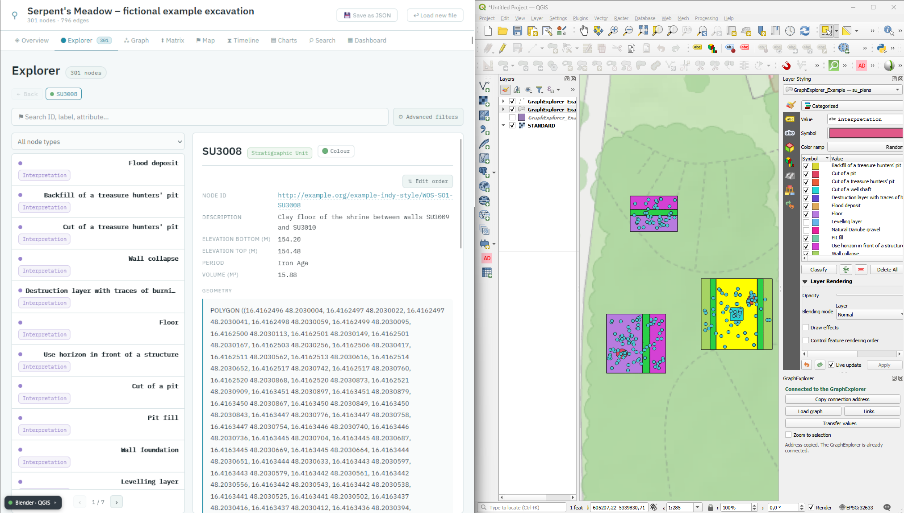
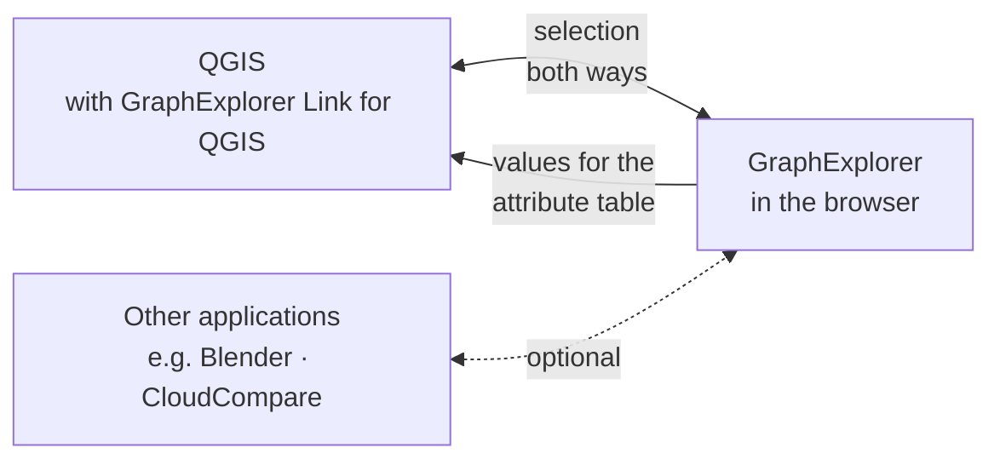
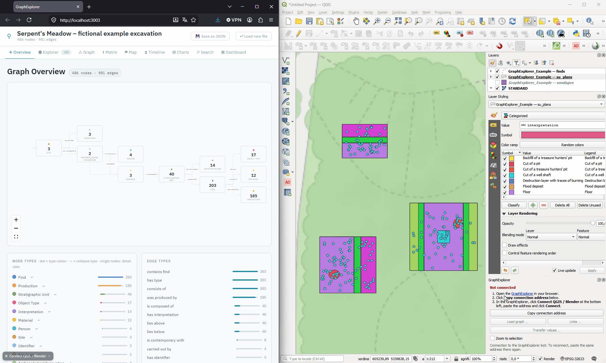
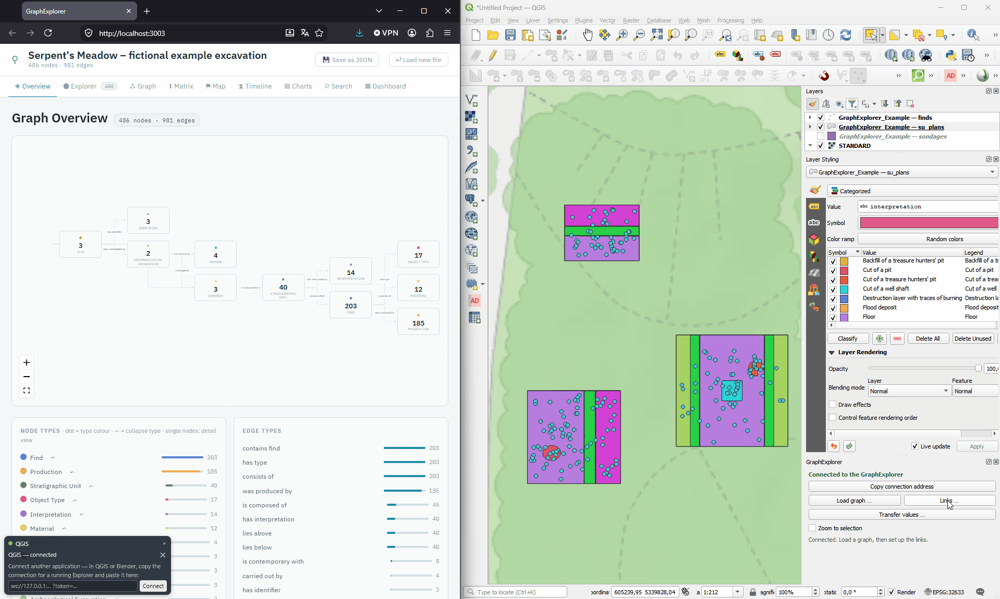
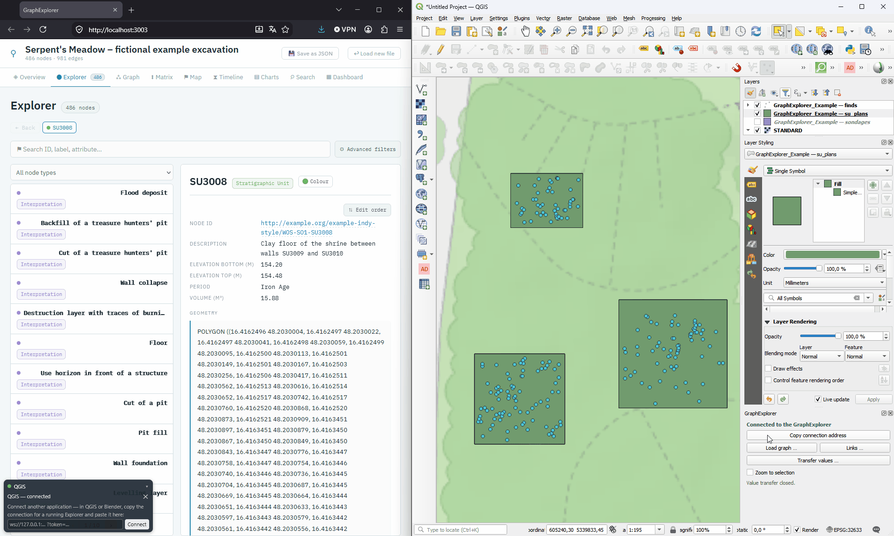

<p align="center">
  <br>
  <strong>GraphExplorer Link for QGIS — your map and your knowledge graph, side by side and in sync.</strong><br>
  Click a feature in QGIS and the <a href="https://github.com/oeai-dac/GraphExplorer">GraphExplorer</a> shows everything the graph knows about it.<br>
  Click something in the GraphExplorer and the matching features light up on the map.<br>
  Copy values from the graph into your attribute table.<br>
  No server, no extra software, and your data never leaves your computer.
</p>

<p align="center">
  
  
  
</p>

<p align="center">
  
</p>

---

## What does it do?

Excavation data usually lives in several places — this plugin connects two of them:

- the **geometries** and other **geographical information** in QGIS — e.g. a polygon for each stratigraphic unit, a point for each find;
- the **knowledge** in a knowledge graph — e.g. what a unit contains, what lies above it, how it is dated, what a find is made of.

**GraphExplorer Link for QGIS** connects the two. You tell it once which layer field matches which information in the graph — for example, the field `label` of your unit plans matches the name of the stratigraphic units in the graph. From then on:

- **Click a polygon in QGIS** → the GraphExplorer opens that unit, with all its finds, its dating and its neighbours in the stratigraphy.
- **Click on a linked node in the GraphExplorer** — in its lists, the Harris matrix or the timeline etc. → the linked geometry is selected in QGIS.
- **Copy values from the graph into the attribute table** — for example the number of finds per unit, or the interpretation — and use them to style, label or analyse your data further.

The graph itself is shown in the **[GraphExplorer](https://github.com/oeai-dac/GraphExplorer)**, a free tool that runs in your web browser. This plugin connects QGIS to it. The same GraphExplorer can be connected to other applications at the same time — such as Blender or CloudCompare with **[GraphExplorer Link for Blender](https://github.com/oeai-dac/GraphExplorer_Blender)** and **[GraphExplorer Link for CloudCompare](https://github.com/oeai-dac/GraphExplorer_CloudCompare)** — so a click in one program updates all the others.



> **New to knowledge graphs?** The [GraphExplorer README](https://github.com/oeai-dac/GraphExplorer#new-to-knowledge-graphs) explains the few terms you need — *node*, *connection*, *attribute* — in plain words.

### Features

- **Selection in both directions** — map → graph and graph → map, live
- **Works with your field names** — any layer field can be matched against a property, the name or the ID of the nodes
- **Forgiving matching** — ignores upper/lower case and extra spaces; can also match `SE 2001` with `2001`, or pick the number out of names like `T2_SE2004`
- **Match report** — shows which units appear in both, which only in the layer and which only in the graph
- **Clever selection** — click a find in the GraphExplorer, and QGIS selects the unit it was found in
- **Values into the attribute table** — properties of the nodes, but also what is connected to them: the number of finds in a unit, their names, their weight
- **Safe** — always shows a preview first, and every transfer can be undone
- **Saved with your project** — links and transfer templates travel with the `.qgz` file
- **QGIS 3 and QGIS 4**

---

## Installation

### What you need

- **QGIS 3.28 or newer** (QGIS 4 works too)
- The **[GraphExplorer](https://github.com/oeai-dac/GraphExplorer#installation)** — installed, or simply its single standalone HTML file. The plugin does not include its own copy: it connects to the GraphExplorer you already use. When you update the GraphExplorer, QGIS benefits straight away.

### Install the plugin

**From QGIS** (once published in the QGIS plugin repository): *Plugins → Manage and Install Plugins…*, search for **GraphExplorer Link for QGIS**, click *Install Plugin*.

**From a ZIP file:** download `graphexplorer_link-<version>.zip` from the [Releases](https://github.com/oeai-dac/GraphExplorer_QGIS/releases) page. In QGIS, open *Plugins → Manage and Install Plugins… → Install from ZIP*, choose the file and click *Install Plugin*.

After installing, you will find the button  **GraphExplorer Link for QGIS** in the toolbar and in the menu *Plugins → GraphExplorer*.

### Update and uninstall

Use *Plugins → Manage and Install Plugins…* as for any other plugin. Your links are saved in your QGIS projects, not in the plugin, so they are kept when you update or reinstall.

---

## User Guide

The GraphExplorer comes with a small, **entirely fictional** excavation, *Serpent's Meadow*: two sites, three sondages, 40 stratigraphic units and 203 finds. The same excavation is available as a knowledge graph and as GIS layers, so you can try everything in a few minutes. The files are in the folder `0_exampleData/` of the GraphExplorer.

### 1. Open the graph in the GraphExplorer

[Start the GraphExplorer](https://github.com/oeai-dac/GraphExplorer#start) and drop `GraphExplorer_Example.json` onto its start page. (If you open the *Map* tab and it asks for a coordinate system, enter `4326`.)

### 2. Open your project or the example data in QGIS

Open your own QGIS project — or, for the example, drag `GraphExplorer_Example.gpkg` into QGIS and add all three layers:

| Layer | Content |
|---|---|
| `sondages` | the three sondages |
| `su_plans` | one polygon per stratigraphic unit |
| `finds` | one point per find |

### 3. Connect QGIS and the GraphExplorer

In QGIS, click  **GraphExplorer Link for QGIS** in the toolbar. A panel opens.

| Element | What it does |
|---|---|
| **Not connected / Connected to the GraphExplorer** | Shows whether the GraphExplorer is connected. While it is not, the panel shows the three steps to connect. |
| **Copy connection address** | Copies the address you paste into the GraphExplorer under *Connect application*. |
| **Load graph …** | Opens a graph JSON file in the connected GraphExplorer. Optional — you can also open the graph in the GraphExplorer itself. |
| **Links …** | Sets up which layer field belongs to which nodes in the graph ([step 4](#4-link-the-geometries-in-qgis-with-the-nodes-in-the-graphexplorer)). |
| **Transfer values …** | Copies values from the graph into the attribute table of a layer ([step 5](#5-transfer-values-into-the-attribute-table)). |
| **Zoom to selection** | When something is selected in the GraphExplorer, the map zooms to it. |

To connect, click **Copy connection address**. Then, in the GraphExplorer, click **Connect application** at the bottom left, paste the address and click **Connect**.

The panel in QGIS now says **Connected to the GraphExplorer**.



The connection address stays the same until you close QGIS. If the connection drops — for example because you closed the browser tab — paste the same address again.

### 4. Link the Geometries in QGIS with the Nodes in the GraphExplorer

A **link** tells the plugin: *this field of this layer* holds the same values as *this information of these nodes*. You can set up as many links as you need — for example one for the unit plans and one for the find points. Click **Links …** to add, change or remove them.

| Field | Meaning |
|---|---|
| **Layer**, **Layer field** | The layer and the field that holds the identifier, e.g. `label` or `SE` |
| **Node type** | Which nodes in the graph belong to this layer, e.g. *Stratigraphic Unit* |
| **Key in the graph** | Where the identifier is stored in the node: in a **node property** (choose it under *Property*), in the **node label** (the name shown in the GraphExplorer) or in the **node ID** |
| **Comparison** | How strictly the values are compared ([see below](#comparison-of-values)) |
| **Pattern** | Your own search pattern, only for the comparison *Pattern* |

**Example — link the stratigraphic units:** click **Links …**, then **Add**, and fill in:

| Field | Choose |
|---|---|
| Layer | `su_plans` |
| Layer field | `label` |
| Node type | *Stratigraphic Unit* |
| Key in the graph | *Node label* |
| Comparison | *Tolerant* (the default) |

Click **Check matches**. The report should say **40 keys linked · 0 only in layer · 0 only in graph** — every polygon has found its unit.



**Example — link the finds as well:** click **Add** again and set up the same for the finds: layer `finds`, field `label`, node type *Find*, key *Node label*. Then click **OK**.

Node types and properties appear under the same names as in the GraphExplorer. Hover over an entry to see its full technical name.

A link can be switched off temporarily by unticking **active**, without deleting it.

#### Check matches

**Check matches** shows how well a link works: how many identifiers are found on both sides, which exist **only in the layer**, which **only in the graph**, and where one identifier belongs to **several features or nodes**. Examples from both sides make it easy to see what is wrong if nothing matches.

The report is useful in its own right: *“12 units in the layer without a node in the graph, 3 nodes without a geometry”* tells you something about your data.

#### Comparison of Values

The values in your layer and in the graph are often written slightly differently. Choose how strictly they are compared:

| Comparison | What it does |
|---|---|
| **Tolerant** (default) | Upper/lower case and extra spaces do not matter: `SE  2001` matches `se 2001` |
| **Trim** | Only spaces at the beginning and end are ignored |
| **Exact** | Every character must match |
| **Digits only** | Only the number counts: `SE 2001` matches `2001`. Values with *several* numbers (`Trench 3, SE 2001`) are left out on purpose — guessing could connect a find with the wrong unit. |
| **Last number** | Takes the last number: `T2_SE2004` matches `2004` — useful when the trench is written in front |
| **Pattern** | A regular expression of your own; the part in brackets is compared. The default `SE[\s_-]*(\d+)` finds the number in `SE2004`, `SE 2004`, `SE-2004`, `se_2004` and `T2_SE2004` |

#### What happens when you click

- **QGIS → GraphExplorer:** select one or more features, and the GraphExplorer opens the matching node. If several nodes match, the first is shown and the panel says how many there were.
- **GraphExplorer → QGIS:** select a node, and the matching features are selected in QGIS. If the node itself has no link — say you clicked a find, but only the units are linked — the GraphExplorer looks at its neighbours (up to two steps away) and uses the nearest linked node, here the unit the find was found in.
- Clearing the selection in QGIS leaves the node open in the GraphExplorer. That is intended: the GraphExplorer always shows one node in detail.

### 5. Transfer Values into the Attribute Table

The link shows map and graph side by side. Sometimes, though, you want information from the graph **in the layer itself**. You can copy values of the nodes — and of what is connected to them — directly into the attribute table of your layers. Click **Transfer values …** to open a dialog with three steps:

1. **Layer and key** — the same fields as for a link. Under **Use settings from** you can fill them in from one of your links, or from a saved template (see below).
2. **Values in the graph** — on the left, everything the nodes offer; on the right, the columns that will be written. **Drag** values from left to right, or double-click them. Double-click a column name to rename it, drag the rows to change their order, and choose a **Type** for each column (text, integer, decimal).
3. **Preview** — the first rows as they would be written, and how many features get a value.

**Example — number of finds and period for each unit:**

1. Under **Use settings from**, choose the link of the unit plans: *Link: … su_plans.label ⇄ Stratigraphic Unit.node label*.
2. In the list on the left, double-click **→ contains find: count** and **Period**. They appear on the right as columns.
3. Click **Preview** to see the first rows, then **Transfer** and confirm.
4. Open the attribute table of `su_plans`: there is a new column `contains_find_count`, and the existing column `period` has been filled from the graph (a column that already exists is updated, not added twice — see [Writing safely](#writing-safely)). The layer is still in edit mode — save it with *Save Layer Edits*, or discard the changes with *Toggle Editing*.

You could now, for example, style the unit plans by the number of finds or by period.



#### What you can transfer

| In the list | Example from the example data |
|---|---|
| A **property** of the node | `Period`, `Elevation top (m)` |
| **Node label** / **Node ID** | `SU1001` |
| **→ connection: count** | *→ contains find: count* — the number of finds in the unit |
| **→ connection: labels** | *→ has interpretation: labels* — `Flood deposit`; *→ contains find: labels* — `TSP-1001-01; TSP-1001-02` |
| **→ connection: property** | *→ contains find: Weight (g)* — the weights of the finds in the unit |

On the `finds` layer, the same works the other way round: *→ consists of: labels* gives the material of each find (`Bronze`), *← was found in: labels* the unit it comes from.

An arrow → means a connection going out from the node, ← one coming in. The last three rows are what makes the transfer worthwhile: this information is not stored in the node itself but in what it is connected to. Each entry shows on how many nodes it occurs, e.g. `(32/40)`: a value that only 32 of 40 units have fills only 32 rows — you see that before the column is created.

#### When there is more than one value

- **Several values for one feature** — a unit with twelve finds has twelve find labels. In a text column they are joined with `; `.
- **Several numbers for one cell** — in a number column only one number fits. If there are several different ones, the cell stays empty, and the case is listed in the report. The plugin does not add them up or pick one, because a guessed number would go unnoticed.

#### Writing safely

- **Transfer** always shows the result first and asks before anything is written.
- If a column with the same name already exists, it is **updated** rather than added a second time. So you can repeat a transfer when the graph has grown. If the existing column has a different type (e.g. text instead of numbers), the plugin stops and tells you.
- Features that have no matching node are left as they are. Tick **Clear features without a node** if those cells should be emptied, so the column shows exactly what the graph knows.
- For **shapefiles**, column names can only be 10 characters long. The plugin shortens them itself and makes sure no two columns end up with the same name.
- The values are written in **edit mode**: the whole transfer is *one* step you can undo, and you can check the attribute table before you save. Tick **Save right away** to save immediately. If the layer was already in edit mode before, the plugin never saves on its own, so it does not save other unfinished changes along with it.

#### Templates

If you transfer the same columns regularly, save them as a **template**: click **Save …** next to *Use settings from* and give it a name. The template stores the layer, the key and the columns, and is saved in the project. Next time, choose it under *Use settings from*. Saving under an existing name replaces that template (the plugin asks first); **Delete** removes the selected template. Nothing is saved automatically.

### Several applications at the same time

The GraphExplorer can be connected to several applications at the same time — for example QGIS, Blender (with [GraphExplorer Link for Blender](https://github.com/oeai-dac/GraphExplorer_Blender)) and CloudCompare (with [GraphExplorer Link for CloudCompare](https://github.com/oeai-dac/GraphExplorer_CloudCompare)). Click a 3D body in Blender or CloudCompare, and the GraphExplorer opens the unit while QGIS selects its polygon — and the other way round. Copy the connection address in each program and paste them all into the GraphExplorer (*Connect application*, then *Connect another application*). The example data includes a matching 3D model for Blender and CloudCompare.

### What is saved where

| What | Where |
|---|---|
| Links, transfer templates, the path of the last graph | In the QGIS **project** (`.qgz`). They belong to this dataset, so they travel with the project. When you open the project, the last graph is only *suggested*, never loaded automatically. |
| The graph | Only in the GraphExplorer in your browser — the plugin does not store it |

---

## Troubleshooting

**The GraphExplorer shows “not connected” after pasting the address**
Each QGIS session has its own address. If you have restarted QGIS or reloaded the plugin, click **Copy connection address** again and paste the new address.

**Clicking in the GraphExplorer works, but clicking in QGIS does nothing**
The plugin has not found the graph side of the link — usually because *Key in the graph* does not fit, or because another graph was opened. Open **Links …** and click **Check matches**.

**“No match — the layer field and the node property do not fit together”**
Compare the examples from both sides in the report. Often another **Comparison** (e.g. *Digits only* or *Pattern*) or another **Key in the graph** (*Node label* instead of a property) solves it.

**“The GraphExplorer is older than this plugin”**
Update the GraphExplorer to the latest version.

**A second browser tab cannot connect**
Only one GraphExplorer can be connected to QGIS at a time — otherwise two tabs would keep changing each other's selection. Close the other tab, or disconnect it with ✕ in its connection bar at the bottom left.

**Changes to the plugin files have no effect**
QGIS keeps a loaded plugin in memory. Restart QGIS after updating the plugin by hand.

**Where are error messages?**
In QGIS under *View → Panels → Log Messages*, tab *GraphExplorer Link for QGIS*. Messages from the GraphExplorer appear in the browser's developer console (F12).

---

## For developers

<details>
<summary><b>How it works: connection, protocol, security</b></summary>

### Why the GraphExplorer runs in the browser

QGIS on Windows does not ship QtWebEngine, and QtWebKit is too old for the GraphExplorer. What every QGIS installation has is **QtWebSockets**. So the plugin runs a small WebSocket server on `127.0.0.1`, and the GraphExplorer — the bridge is built into it (`src/explorer-bridge.js`) — connects to it. A WebSocket is always opened by the browser; the applications are the servers. This is also why several applications — such as QGIS, Blender and CloudCompare — can share one GraphExplorer without depending on each other.

### Protocol

JSON in both directions, three forms:

```
QGIS → Browser    {"id": 7, "method": "collectKeys", "args": [...]}
Browser → QGIS    {"id": 7, "result": ...}
Browser → QGIS    {"event": "selection", "nodeId": "...", "keys": [...]}
```

For the selection, QGIS never sees node IDs, only keys (`2001`), so it needs to know nothing about the structure of the graph. The same goes for the transfer: `describeValues` says *which* values the nodes could provide, `collectValues` delivers them per key, and QGIS decides which row gets what.

```
QGIS                                    GraphExplorer (browser)
─────────────────────────────────────────────────────────────────
layer.selectionChanged
  → LinkIndex: feature ID → key
  → LinkIndex: key → node ID
  → {"method":"selectNodes"}  ───────▶  open the node

                                        selected node changes
                                          → resolve keys (up to 2 hops)
  {"event":"selection"}       ◀───────  send
  → LinkIndex: key → feature IDs
  → layer.selectByIds()
```

### Interface version

On connecting, the GraphExplorer reports an interface version (`API_VERSION` in its `src/main.jsx`). The plugin checks for **at least** the version it needs (currently 2; version 3 adds the display names), not for exactly that version: the bridge gains methods but never loses any, and since several applications can share one GraphExplorer, an equality check would turn every extension for one into a failure for the others.

### Access token

The server listens only on `127.0.0.1`, but “local” does not mean “only us”: any other program on the computer, and any web page in an open tab, could otherwise connect and read the loaded graph. Each QGIS session therefore gets a random token. It is part of the copied address (`ws://127.0.0.1:<port>/?token=…`), and the GraphExplorer has to present it as its first message; anything else is refused. Treat the address like a password — it is only valid for the current QGIS session.

### Feedback lock

Without a lock, the two sides would select each other endlessly. `layersync.py` sets a flag while it writes a selection from the GraphExplorer into the layers; `selectByIds` emits `selectionChanged` synchronously, so the flag is guaranteed to be up.

</details>

<details>
<summary><b>Install from source, project structure, tests</b></summary>

### Install from source

Clone the repository into the QGIS plugin folder, under the folder name `graphexplorer_link`:

```bash
# Windows
cd "%APPDATA%\QGIS\QGIS3\profiles\default\python\plugins"
# Linux:  ~/.local/share/QGIS/QGIS3/profiles/default/python/plugins
# macOS:  ~/Library/Application Support/QGIS/QGIS3/profiles/default/python/plugins

git clone https://github.com/oeai-dac/GraphExplorer_QGIS.git graphexplorer_link
```

Restart QGIS and enable the plugin under *Plugins → Manage and Install Plugins… → Installed*. After changing the code, restart QGIS — the Plugin Reloader does not always reload all modules.

To build the installable ZIP:

```bash
python scripts/make-zip.py      # writes dist/graphexplorer_link-<version>.zip
```

### Project structure

```
GraphExplorer_QGIS/
├── __init__.py          classFactory for QGIS
├── plugin.py            menu, toolbar, lifetime of the panel
├── dock.py              the panel: controls and status
├── wsserver.py          WebSocket server, protocol, access token
├── layersync.py         read/set layer selections, feedback lock
├── linking.py           the matching itself — no QGIS import, testable
├── transfer.py          the value transfer — no QGIS import, testable
├── attrwrite.py         create and fill fields (touches the layer)
├── linkform.py          the join-key form, used by both dialogs
├── config_dialog.py     set up links
├── transfer_dialog.py   put together and transfer values
├── settings.py          storage in the QGIS project
├── compat.py            Qt5/Qt6 and module availability
├── metadata.txt         plugin metadata for QGIS
├── icon.png / icon.svg
├── scripts/
│   └── make-zip.py      builds the installable ZIP
└── tests/
    ├── run-linking-checks.py    matching (plain Python, no QGIS)
    └── run-transfer-checks.py   value transfer (plain Python, no QGIS)
```

`linking.py` and `transfer.py` deliberately have **no QGIS or Qt imports**, so the part where real data meets can be tested without QGIS. Code comments are in German.

### Tests

```bash
python tests/run-linking-checks.py
python tests/run-transfer-checks.py
```

The browser side of the bridge is tested in the GraphExplorer repository (`npm run check`).

</details>

---

## License

GPL 3.0 or later — see [LICENSE](LICENSE).

---

## AI Assistance

GraphExplorer Link for QGIS was developed with the AI coding assistant [Claude Code](https://claude.com/claude-code) by Anthropic. Claude was used to write and refactor code, to review it against the documentation, and to help with drafting the documentation. The concept, the requirements and the testing come from the author; every change was reviewed before it was adopted.

---

## Acknowledgments and Credits

Developed for digital archaeology and cultural heritage data management, as a companion to the [GraphExplorer](https://github.com/oeai-dac/GraphExplorer) and [OntoCartographer Studio](https://github.com/oeai-dac/OntoCartographer-Studio).
